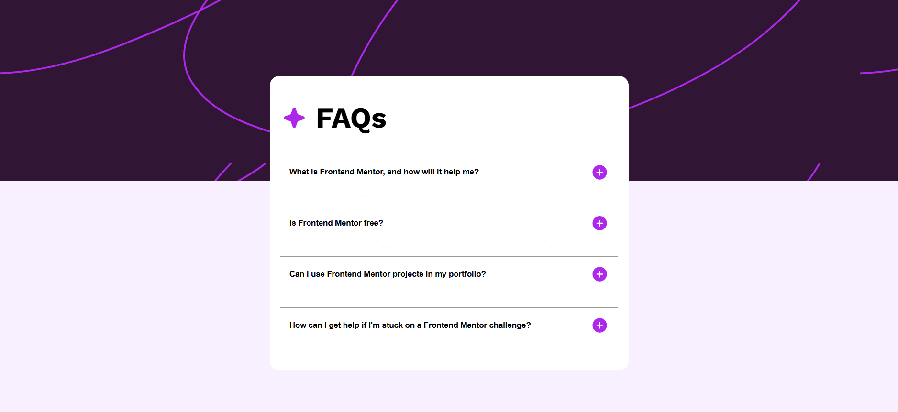

# Frontend Mentor - FAQ accordion

Projeto desenvolvido como solução para o desafio [FAQ accordion do Frontend Mentor](https://www.frontendmentor.io/challenges/faq-accordion-wyfFdeBwBz). 

A aplicação apresenta uma seção de perguntas frequentes em formato de acordeão, com layout responsivo e interatividade desenvolvida com JavaScript.

## Sumário

- [Visão geral](#visão-geral)
- [Captura de tela](#captura-de-tela)
- [Funcionalidades](#funcionalidades)
- [Tecnologias](#tecnologias)
- [Como executar](#como-executar)
- [O que aprendi](#o-que-aprendi)
- [Próximos passos](#próximos-passos)
- [Recursos](#recursos)
- [Colaboração com IA](#colaboração-com-ia)
- [Autor](#autor)
- [Objetivo educacional](#objetivo-educacional)
- [Contribuições](#contribuições)
- [Agradecimentos](#agradecimentos)

## Visão geral

O objetivo deste desafio foi reproduzir uma interface de perguntas frequentes com base nos designs disponibilizados pelo Frontend Mentor para desktop e dispositivos móveis.

A página contém quatro perguntas. Ao selecionar uma delas, sua resposta é exibida ou ocultada. Quando uma nova pergunta é aberta, as demais respostas são fechadas.

### Captura de tela

### ✨ Funcionalidades

- ⚡ **Interatividade** - permite abrir e fechar as respostas ao selecionar as respectivas perguntas.
- 📱 **Layout responsivo** - Ajustes de layout para diferentes larguras de tela, incluindo dispositivos móveis.
- 🔗 **Uma resposta por vez** - Fecha as demais respostas quando uma nova pergunta é aberta.
- ♿ **Interação por teclado** - As perguntas podem ser acessadas e ativadas pelo teclado usando os botões.

## 🛠️ Tecnologias utilizadas

- **HTML5** - Estrutura semântica da página
- **CSS3** - Estilos com Flexbox, propriedades personalizadas e media queries
- **JavaScript** - Interação e funcionalidade da página
- **Work Sans** - Fonte usada no projeto

## 🚀 Como executar

Não é necessário instalar dependências.

Clone este repositório ou faça o download dos arquivos.

Abra a pasta do projeto.

Abra o arquivo index.html em seu navegador.

## 🧠 O que aprendi

Este projeto foi um grande aprendizado, pois foi o primeiro em que criei a estrutura JavaScript sozinho. No começo, tive bastante dificuldade para dar o primeiro passo. Aos poucos, fui pesquisando e escrevendo linha por linha, o que me ajudou a destravar. 

Durante o desenvolvimento, pratiquei:

- Seleção de elementos do DOM.

- Uso de eventos para capturar interações do usuário.

- Manipulação de classes CSS com JavaScript.

- Uso de condicionais para controlar o comportamento dos elementos.

- Lógica para exibir e ocultar respostas, mantendo apenas uma aberta por vez.

Também utilizei o GitHub Copilot como apoio para esclarecer dúvidas e superar dificuldades durante o desenvolvimento, buscando compreender a lógica implementada.

## 👣 Próximos passos

- Conferir o comportamento das respostas em telas bem estreitas, como 320 px.

- Revisar os estados de foco e os nomes acessíveis dos controles.

- Aprimorar a acessibilidade e validar o comportamento da interface em diferentes navegadores.

## 💻 Recursos

- [Desafio FAQ accordion no Frontend Mentor](https://www.frontendmentor.io/challenges/faq-accordion-wyfFdeBwBz)
- [MDN: eventos de clique](https://developer.mozilla.org/pt-BR/docs/Web/API/Element/click_event)
- [MDN: media queries](https://developer.mozilla.org/pt-BR/docs/Web/CSS/CSS_media_queries/Using_media_queries)

## 🤖 Colaboração com IA

Este projeto também contou com auxílio de ferramentas de inteligência artificial para apoiar no processo de desenvolvimento, especialmente na resolução de dúvidas de estrutura e estilização.

Ferramenta utilizada:

- GitHub Copilot

## 👨‍💻 Autor

Feito com ❤️ por Ricardo Fernandes

- [GitHub](https://github.com/RicoAraujo)

## 📚 Objetivo educacional

Este projeto é baseado em um desafio do Frontend Mentor e foi desenvolvido para fins educacionais.

## 🤝 Contribuições
Sugestões, melhorias e pull requests são bem-vindos.

## Agradecimentos

Obrigado ao Frontend Mentor pelo desafio e pelos designs usados como referência para este projeto.

Se curtiu o projeto, deixe uma ⭐ no repositório!